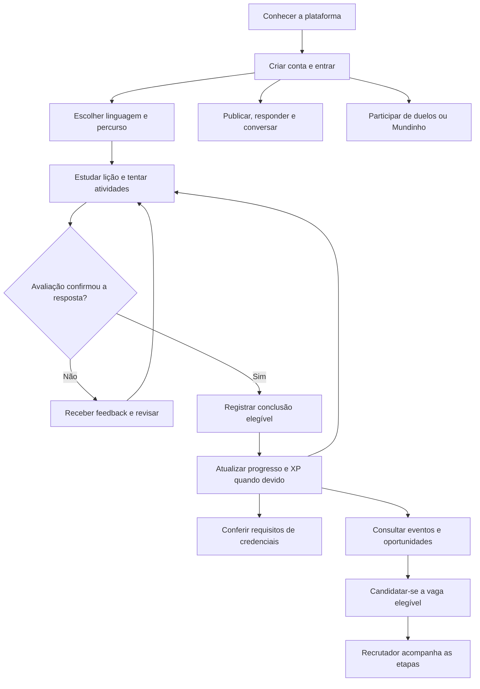

# Visão do sistema e do negócio

## Problema e proposta

O Stacklyst reúne aprendizagem e prática de programação, troca de conhecimento, competição e oportunidades profissionais. O usuário pode estudar uma linguagem, executar exercícios, acompanhar evidências de progresso, compartilhar conteúdo e participar de atividades sociais e competitivas. Empresas e recrutadores organizam vagas e candidaturas. Avaliadores aprovados realizam os pareceres permitidos pelo fluxo de revisão.

O centro pedagógico está nas trilhas: o sistema precisa distinguir exposição a um conteúdo, tentativa, execução de código, primeira conclusão e evidência de aprendizagem. A gamificação apresenta incentivos; não substitui essas distinções. XP, moedas do Mundinho, reputação de avaliador e certificado são registros diferentes.

## Atores

| Ator                     | O que representa                                 | Limite relevante                                                            |
| ------------------------ | ------------------------------------------------ | --------------------------------------------------------------------------- |
| Usuário                | Pessoa sem sessão autenticada                    | Acesso depende da rota; a existência de uma URL não torna o recurso público |
| Usuário                  | Conta autenticada usada em estudo e comunidade   | Opera seus próprios dados e os recursos cuja audiência permite acesso       |
| Participante de duelo    | Usuário comprometido com uma partida             | Deve pertencer ao duelo; conhecer o ID não permite enviar solução           |
| Amigo mútuo              | Duas contas que se seguem nas duas direções      | É relação social, não papel administrativo                                  |
| Avaliador                | Usuário aprovado no fluxo específico             | Status, tecnologia e conflitos ainda são conferidos                         |
| Recrutador               | Papel que permite ações de recrutamento          | Precisa de acesso à empresa correspondente                                  |
| Administrador            | Papel de gestão da plataforma                    | Operações sensíveis continuam sujeitas às regras e auditoria                |
| Provedor de autenticação | Supabase Auth                                    | Identifica sessão; os dados de domínio também precisam existir no banco     |
| Executor de código       | Sandbox local de JS/TS e provedores configurados | Pode estar indisponível; falha operacional não demonstra erro do aluno      |
| Serviço de push          | Canal de entrega para dispositivos registrados   | É diferente do registro persistido da notificação                           |

Os quatro valores de `UserRole` são `USER`, `EVALUATOR`, `ADMIN` e `RECRUITER`. Amizade, inscrição, dono de empresa e participante são relações e condições adicionais. Não se pode resolver todas as permissões por um único `if (role)`.

## Jornada principal

Esse diagrama representa atividade do negócio. Não descreve a ordem de funções em uma única requisição. Publicar, competir e estudar são caminhos disponíveis conforme permissões; não são etapas obrigatórias de um funil único.

## Principais objetos de informação

- **Conta:** identidade, papel, perfil, preferências e relações sociais.
- **Conteúdo pedagógico:** curso, lição, etapa, nó, caminho, exercício e caso de teste.
- **Evidência pedagógica:** tentativa, execução, submissão, conclusão e evento de aprendizagem.
- **Reconhecimento:** XP, nível, faixa, título e credencial com snapshot verificável.
- **Comunidade:** publicação, resposta encadeada, reação, enquete, mídia, salvamento e mensagem.
- **Competição:** convite, duelo, submissão, solução, decisão e parecer.
- **Mundinho:** jogador RPG, inventário, equipamento, saldo, extrato, batalha e sala multiplayer.
- **Oportunidade:** empresa, vaga, etapa, candidatura, evento, desafio e participação.

O schema relaciona esses objetos, mas não contém sozinho todas as regras: algumas estão em Zod, nos serviços, nos repositórios e nas funções puras.

## Fronteiras importantes

### Aprendizagem versus competição

Executar uma solução de exercício verifica o contrato daquele exercício. Comparar duas soluções de duelo aplica política competitiva. No Mundinho, o código precisa produzir o traço e cumprir estruturas do cenário. Aprovação em um desses contextos não implica aprovação automática nos outros.

### Aparência versus autoridade

Nome colorido, moldura, roupa e título são apresentação. Não concedem papel de administrador ou avaliador. Na coleção editorial, os perfis são fictícios e identificados como demonstração; títulos e XP ilustrativos não equivalem a credenciais de formação.

### Interface versus confirmação

Um botão pode mostrar carregamento ou atualizar estado temporariamente. Confirmação de compra, XP, resgate ou candidatura depende da resposta do servidor e do commit. Atualizar um número na tela não basta para provar persistência.

### Web versus mobile

A aplicação web usa Next.js. O aplicativo está em `apps/mobile`, com Expo/React Native e pontes autenticadas. O Mundinho embarca interface e arte; operar sem carregar a arte da rede não torna duelos, saldo e presença multiplayer independentes do servidor.

## O que não concluir a partir do produto

Uma posição no ranking representa a métrica e o período selecionados, não uma certificação absoluta de competência. Tempo estimado de aula não é medição de horas estudadas. Uma assinatura desenhada em PDF não é uma assinatura digital criptográfica. Uma estimativa de Big-O não é demonstração formal de complexidade.

Essas fronteiras ajudam tanto na apresentação acadêmica quanto na manutenção: cada afirmação deve ser sustentada pelo fluxo implementado e pela evidência adequada.
